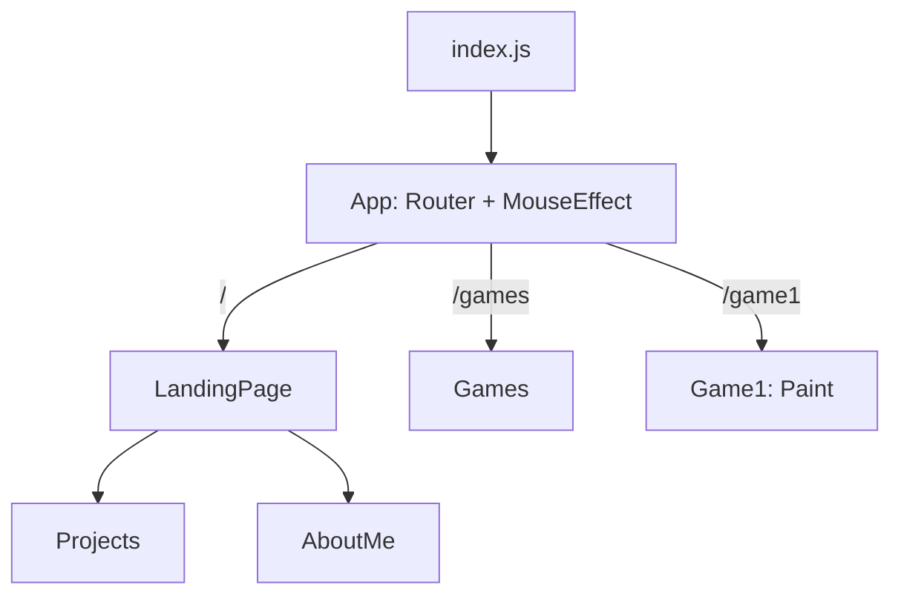

# Orbitfolio

> Personal portfolio site of Praneetha Potharaju, built with React and Tailwind CSS.

A newer portfolio built with Next.js lives in the [`praneethap`](https://github.com/Praneetha1844/praneethap) repository. Orbitfolio is kept as the earlier version.

## What it includes

- **Landing page** with a full-screen background video that zooms slightly as you scroll (disabled under `prefers-reduced-motion`), smooth-scroll navigation and a cursor ring that follows the mouse on devices with a fine pointer.
- **Projects** section: cards linking to GitHub repositories (WasteWhizIBM, WingDash, InkSense, ShuntCalc), revealed with a scroll animation (IntersectionObserver).
- **About** section with a profile photo and links to LinkedIn and GitHub.
- **Games** page with a **Paint** canvas toy (colour picker, brush size, clear) that works with mouse, pen and touch.

## Tech stack

React 18, React Router 7, Tailwind CSS 3, Create React App (`react-scripts` 5), Jest and Testing Library.

## Architecture



The landing page is a single scrolling page composed of `Projects` and `AboutMe`; `Games` and `Game1` are separate routes. Project data is a constant array in `src/Projects.jsx`.

## Project structure

```
src/
  index.js          entry point
  App.js            routes
  LandingPage.jsx   hero, nav, footer
  Projects.jsx      project cards (data + scroll animation)
  AboutMe.jsx       bio and links
  Games.jsx         games index
  Game1.jsx         paint canvas
  MouseEffect.jsx   cursor ring
  *.test.js         Jest and Testing Library tests
public/             favicon, manifest, media
docs/               architecture, roadmap
```

## Getting started

Requires Node.js 20+.

```bash
npm install
npm start        # http://localhost:3000
```

## Scripts

| Script | Description |
|---|---|
| `npm start` | Dev server |
| `npm test` | Run tests (watch mode) |
| `npm run test:ci` | Run tests once |
| `npm run lint` | ESLint (`react-app` config) |
| `npm run build` | Production build into `build/` |

## Limitations

- Create React App is no longer maintained; a move to Vite is planned.
- The hero video (`public/bgvideo1.mp4`) is ~38 MB, which is heavy for a landing page.
- Project descriptions are static text; one entry links to a team repository that is not owned by this account.
- Tests cover the project list, the cursor and the games index; the landing page and the Paint canvas are not tested.
- The tests were written without being run in a development environment, and CI has not been exercised yet.
- The Paint canvas needs a mouse, pen or touch; there is no keyboard drawing.
- Web fonts are loaded from Google Fonts.

## Roadmap

- [ ] Migrate from Create React App to Vite
- [ ] Compress or stream the hero video
- [ ] Contact section
- [ ] More in [docs/ROADMAP.md](docs/ROADMAP.md)

## Assets

- `public/bgvideo1.mp4` (about 38 MB): hero background video. Its source and licence are not recorded in this repository.
- `public/doi.jpg`: a personal photo of the site owner.
- `public/logo192.png`, `public/logo512.png`: the default Create React App icons (same file sizes as the template); replace them with your own.

## More documentation

[docs/index.md](docs/index.md) · [Security policy](SECURITY.md)

## License

Code: [MIT](LICENSE) © 2026 Praneetha Potharaju. Personal photos and media in `public/` are not covered by this license.
