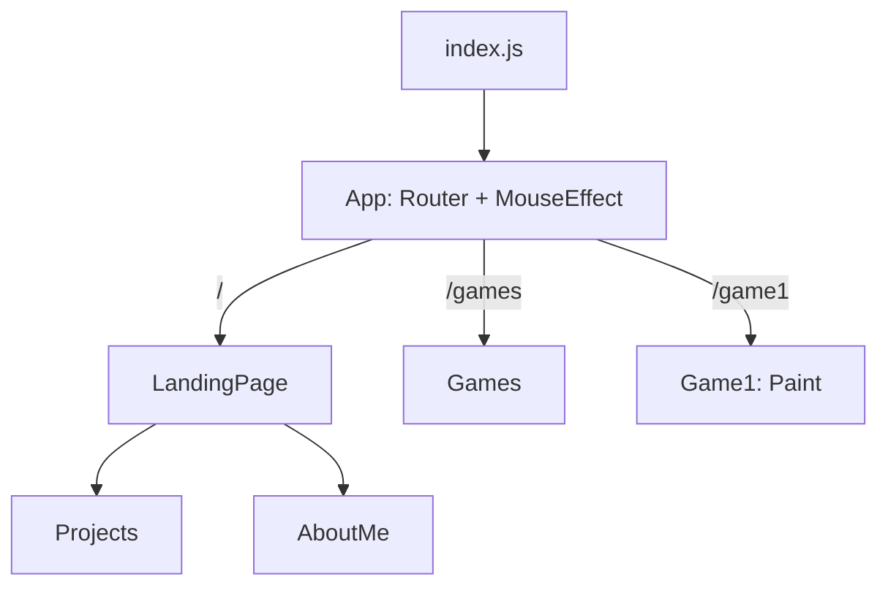

# Orbitfolio

> Personal portfolio site of Praneetha Potharaju, built with React and Tailwind CSS.

## What it includes

- **Landing page** with a full-screen background video that zooms slightly as you scroll, smooth-scroll navigation and a custom cursor.
- **Projects** section: cards linking to GitHub repositories, revealed with a scroll animation (IntersectionObserver).
- **About** section with a profile photo and links to LinkedIn and GitHub.
- **Games** page with a **Paint** canvas toy (colour picker, brush size, clear).

## Tech stack

React 18, React Router 7, Tailwind CSS 3, Create React App (`react-scripts` 5), Jest and Testing Library.

## Architecture



The landing page is a single scrolling page composed of `Projects` and `AboutMe`; `Games` and `Game1` are separate routes. Project data is a constant array in `src/Projects.jsx`.

## Project structure

```
src/
  index.js          entry point
  App.js            routes
  LandingPage.jsx   hero, nav, footer
  Projects.jsx      project cards (data + scroll animation)
  AboutMe.jsx       bio and links
  Games.jsx         games index
  Game1.jsx         paint canvas
  MouseEffect.jsx   custom cursor
public/             favicon, manifest, media
```

## Getting started

Requires Node.js 20+.

```bash
npm install
npm start        # http://localhost:3000
```

## Scripts

| Script | Description |
|---|---|
| `npm start` | Dev server |
| `npm test` | Run tests |
| `npm run build` | Production build into `build/` |

## Limitations

- Create React App is no longer maintained; a move to Vite is planned.
- The hero video (`public/bgvideo1.mp4`) is ~38 MB, which is heavy for a landing page.
- Project descriptions are static text; one entry links to a team repository that is not owned by this account.
- Only one unit test so far.
- The Paint canvas uses mouse events only (no touch or keyboard drawing).

## Roadmap

- [ ] Migrate from Create React App to Vite
- [ ] Compress or stream the hero video
- [ ] Contact section
- [ ] Touch support for the Paint game
- [ ] More tests

## License

Code: [MIT](LICENSE) © 2026 Praneetha Potharaju. Personal photos and media in `public/` are not covered by this license.
